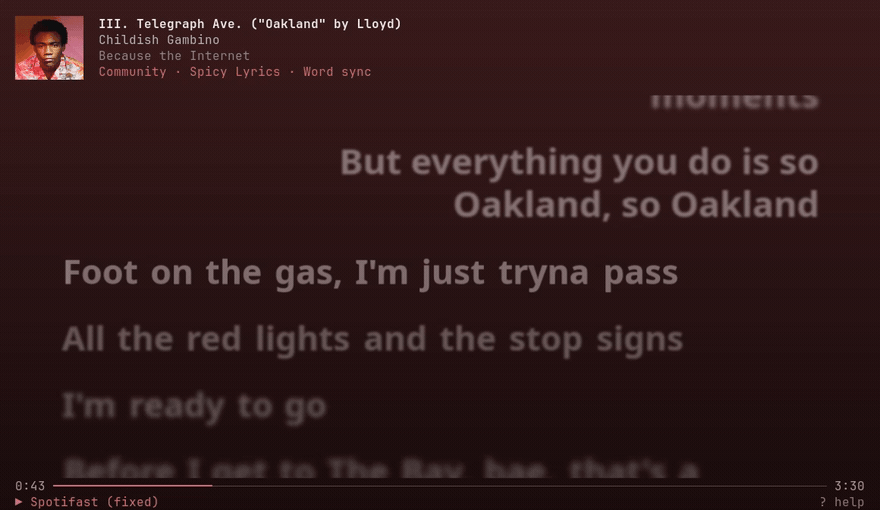
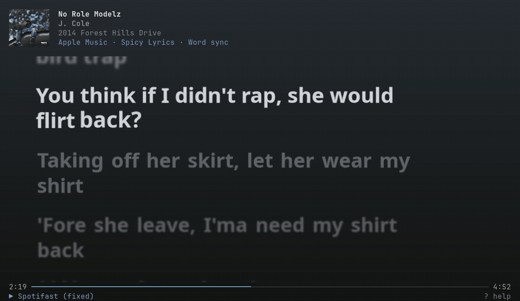

# Lyrminal

Synced lyrics in your terminal. Lyrminal follows whatever your MPRIS player is playing, finds word-synced lyrics for it and animates them line by line, word by word.

<table>
  <tr>
    <td align="center" width="50%">
      
      <br>
      <a href="https://open.spotify.com/track/0fgosF2PWrYbyy9e7BclKz"><i>III. Telegraph Ave. ("Oakland" by Lloyd)</i> by Childish Gambino</a>
    </td>
    <td align="center" width="50%">
      
      <br>
      <a href="https://open.spotify.com/track/68Dni7IE4VyPkTOH9mRWHr"><i>No Role Modelz</i> by J. Cole</a>
    </td>
  </tr>
</table>

> [!WARNING]
> **This project is vibe-coded.** Almost all of the code was written by an AI coding assistant under my direction. It works for me, but it hasn't had the careful line-by-line review you'd expect from hand-written software. Read the code before you trust it with anything important.

> [!CAUTION]
> **There is no guarantee that this project will be maintained.** I may stop working on it at any time, and issues or pull requests may never get an answer. If a lyrics provider changes its API, things may just break.

## Contents

- [Features](#features)
- [Requirements](#requirements)
- [Installation](#installation)
- [Quick start](#quick-start)
- [Key bindings](#key-bindings)
- [How lyrics are picked](#how-lyrics-are-picked)
- [Lyrics providers](#lyrics-providers)
- [Local library](#local-library)
- [Appearance](#appearance)
- [Timing and sync](#timing-and-sync)
- [Playback controls](#playback-controls)
- [Files](#files)
- [Troubleshooting](#troubleshooting)
- [Credits](#credits)
- [Disclaimer](#disclaimer)
- [License](#license)

## Features

- **Follows your player** over MPRIS. Works with any MPRIS player and works best with [Spotifast](https://github.com/crmne/spotifast).
- **Word-, line- and unsynced lyrics** from six sources, all queried at the same time. The best sync wins.
- **Two renderers**:
  - **Pixel**: real fonts with blur, scaling and glow, drawn with the kitty graphics protocol (the GIFs above).
  - **Cell**: truecolor terminal text that works in any modern terminal. Lyrminal falls back to it when the terminal can't show images.
- **Two animation styles**:
  - **Spring**: a per-word gradient wipe with glow and springy emphasis.
  - **Bloom**: one soft edge sweeping the line, rippling scroll and flame emphasis.
- **Look presets**: switch between the default "Lyrminal" look and a "Spicy Lyrics" look in one go.
- **Album-art theming**: lyrics and background take their colours from the album cover, with the cover shown in the header, with rounded corners, when the terminal can show images.
- **Duets, background vocals, translations and romanization** when the sync has them. Duet singers sit on opposite sides.
- **Interlude dots** during instrumental breaks.
- **Local library**: import your own syncs from a file, the clipboard or a URL, in [many formats](#local-library).
- **Per-track timing offsets**, set live while the song plays and remembered for next time.
- **Playback controls**: play/pause, seek, skip, scrub the progress bar and click a lyric to jump to it. Turn them off to keep Lyrminal read-only.
- **Mouse support**: wheel scrolling and clicking through lyrics, dialogs and settings.
- **In-app settings** for everything, plus a short welcome tour on first launch.
- **Cached lyrics**, so repeat plays need no requests.
- **In-app updates**: get told about new releases and install them without leaving Lyrminal.

## Requirements

- **Linux** with a D-Bus session bus (MPRIS).
- **A truecolor terminal.**
- **For the pixel renderer and cover art**: a terminal with the kitty graphics protocol, such as kitty, Ghostty or WezTerm. It doesn't work inside tmux or screen. Without it, Lyrminal uses the cell renderer and hides the settings that only work with images.
- **A music player that speaks MPRIS**: Spotifast, Spotify, most browsers, mpv with an MPRIS plugin, and so on.
- **Optional, for importing from the clipboard**: `wl-paste` (Wayland), `xclip` or `xsel`.

## Installation

### Install script

```sh
curl -fsSL https://raw.githubusercontent.com/BajekekButLost/lyrminal/main/install.sh | sh
```

It downloads the latest release to `~/.local/bin/lyrminal`. Where there's no prebuilt binary (anything other than Linux x86_64), it builds from source with `cargo` instead. Run the same command again to update, or [update from inside the app](#updating).

Pass options after `sh -s --`:

```sh
curl -fsSL https://raw.githubusercontent.com/BajekekButLost/lyrminal/main/install.sh | sh -s -- --version v1.0.0 --dir ~/bin
```

| Option | What it does |
| --- | --- |
| `-v`, `--version <vX.Y.Z>` | Install a specific version instead of the latest |
| `-d`, `--dir <path>` | Install somewhere other than `~/.local/bin` |
| `-s`, `--from-source` | Build with `cargo` even when a prebuilt binary exists |
| `-f`, `--force` | Reinstall even if that version is already installed |

`LYRMINAL_VERSION` and `LYRMINAL_INSTALL_DIR` work the same as `--version` and `--dir`.

### Prebuilt binary

Download `lyrminal-vX.Y.Z-x86_64-linux` from the [latest release](https://github.com/BajekekButLost/lyrminal/releases/latest), then:

```sh
chmod +x lyrminal-v*-x86_64-linux
mv lyrminal-v*-x86_64-linux ~/.local/bin/lyrminal
lyrminal --version
```

Only Linux x86_64 binaries are published. On anything else, build from source.

### From source

You need a recent stable Rust toolchain (edition 2024).

```sh
git clone https://github.com/BajekekButLost/lyrminal.git
cd lyrminal
cargo install --path . --locked
```

To update, pull and run the same `cargo install` command again.

### Updating

Lyrminal looks for a new release on GitHub when it starts and every 12 hours while it runs. When one is out, it says so and shows "update vX.Y.Z" in the status bar. Press `U` (or click that) to open Settings → Updates, then Enter to download it. The download is checked with `--version` before it replaces the running copy, and Enter once more restarts into the new version. Otherwise the new version starts the next time you open Lyrminal.

- **Check for updates** (on by default): turn it off and Lyrminal never contacts GitHub on its own. Enter on "Lyrminal update" still checks by hand.
- **Install updates automatically** (off by default): download and install a new release as soon as it is found.

In-app updates need a prebuilt binary for your system (Linux x86_64) and write access to the folder Lyrminal is in. Builds running from a `cargo build` `target/` folder don't update themselves; pull and rebuild them instead.

## Quick start

1. Start your music player and play something.
2. Run `lyrminal`.
3. On the first launch, a short welcome tour docks next to the lyrics and walks you through:
   - what your terminal can show, when it has no kitty graphics (with a warning if tmux, screen or missing truecolor is in the way),
   - choosing a player,
   - ordering the lyrics providers and, optionally, adding your own Spicy Lyrics key,
   - picking a folder for your own syncs,
   - playing a song,
   - changing the look live,
   - the most useful keys.

   You can skip it at any time and run it again from Settings → About → Welcome tour.
4. Press `Esc` for settings and `?` for every key.

```text
Usage: lyrminal [options]
```

| Option | What it does |
| --- | --- |
| `-h`, `--help` | Show the options and where the config file is |
| `-V`, `--version` | Show the version |
| `--base-directory <dir>` | Use `<dir>` as the home folder for Lyrminal's files, so they go to `<dir>/.config/lyrminal`, `<dir>/.cache/lyrminal` and so on. The folder is created if it doesn't exist |
| `--temp-base-directory` | The same, in a new randomly named folder in the system temp directory. Its path is printed when you quit, and it is not deleted |

Everything else is set inside the app.

## Key bindings

Every key, grouped like the in-app help, is listed in **[KEYBINDINGS.md](KEYBINDINGS.md)**. In the app, press `?` to see them.

## How lyrics are picked

When a song starts, every enabled provider is asked at the same time. The results are judged in your priority order:

- **The best sync wins**: word sync beats line sync, which beats unsynced lyrics.
- **Ties go to the priority order**: when two providers have the same kind of sync, the one higher in the list wins.
- **Your local library comes first** when "Prioritize local library" is on (the default). A saved sync that clearly matches the song beats every provider below the library in the list, even one with a better sync. Providers above it still need a strictly better sync to win.
- **Prefer synced lyrics** (Settings → Lyrics) can be turned off to just take the first provider that has any lyrics.

Lyrminal stops waiting as soon as the winner is certain, so a slow provider doesn't hold up the lyrics.

Not happy with the pick? Press `s` to see every result from every provider and choose another. Your choice is remembered for that song. Press `R` to fetch everything again without the cache.

## Lyrics providers

Reorder providers, turn them on or off, and change their options in Settings → Providers. Enter opens a provider's settings, Space toggles it, and `Shift+↑`/`↓` or `K`/`J` move it.

| # | Provider | Key needed | How it looks songs up |
| --- | --- | --- | --- |
| 1 | Local library | No | Your own saved syncs, matched by title, artist and length |
| 2 | [Spicy Lyrics](https://spicylyrics.org) | Optional | By Spotify ID when the player exposes one, otherwise by search |
| 3 | [lrc.red](https://lrc.red) | No | By ISRC when the player exposes one, otherwise by title and artist |
| 4 | [Better Lyrics (Unison)](https://unison.betterlyrics.org) | No | By searching title and artist |
| 5 | [lrcmux](https://lrcmux.dev) | No | By title, artist, album and length; gathers syncs from Deezer, KuGou and YouTube Music |
| 6 | [LRCLIB](https://lrclib.net) | No | By title, artist, album and length, then a search |

### Spicy Lyrics

Spicy Lyrics returns community syncs first, then Apple Music and Spotify syncs. It works out of the box with Lyrminal's built-in key, which everyone shares.

**Your own key (optional):** a key of your own gets a rate limit of its own.

1. Create a secret key at [developers.spicylyrics.org](https://developers.spicylyrics.org) → Dashboard → Applications.
2. Paste it into Settings → Providers → Spicy Lyrics → API key. Entering a key turns on "Use your own key"; turn that off to go back to the built-in key. Or set the `SPICY_LYRICS_SECRET_KEY` environment variable, which takes precedence even when "Use your own key" is off.

When the player doesn't give a Spotify ID, "Auto-match" decides how loose a search match Spicy Lyrics may pick on its own: `exact`, `likely`, `version`, `other artist` or `related`. A different version of a song has different timings, so `exact` (the default) is safest.

Spicy Lyrics' search finds tracks, not lyrics, so some of its results in the sync picker (`s`) may have no lyrics at all. With **Check results** on (the default), Lyrminal asks for the lyrics of the first results and only lists the ones that have them; the rest aren't listed. **Results to check** sets how many, from 1 to 20 (5 by default). Each one is a request against the key's rate limit. Turn Check results off to list every result unchecked, using a single request.

### Matching other copies of a song

Most providers have a **Duration tolerance**. Lyrics for another copy of a song, such as the same track in a different player or on a different album, are used when the title and artist match and the length differs by at most this many seconds (2 s by default).

### Credits

Lyrminal always shows where the lyrics came from:

- The provider and its source (for example "Spicy Lyrics · Apple Music" or "lrcmux · Deezer") appear in the track header, or under the lyrics when the header is hidden.
- Community syncs credit the people who made them, with links, on one line under the lyrics.
- lrc.red, LRCLIB and Unison are credited and linked under the lyrics, as their terms ask. Follow Unison's song link to vote on, report or fix a sync.

## Local library

Press `L` to open the library. It shows your saved syncs as cards; press `i` or choose "Import a new sync" to add one for the playing song.

**Sources:**

- **File**: starts in your default folder, set in Settings → Providers → Local library or during the welcome tour.
- **URL**: any `http://` or `https://` address that returns a lyrics file.
- **Clipboard**: needs `wl-paste`, `xclip` or `xsel`.

**Saved or temporary:**

- **Saved** syncs are kept in your library and used whenever the song plays again.
- **Temporary** syncs only last for the current session and the current song.

**Check for changes** (on by default for saved syncs) re-reads the original file or URL every time the sync loads, so edits show up right away. If the source is gone, the saved copy is used instead.

**Supported formats** (detected automatically):

- LRC, including enhanced LRC with word timings
- TTML (Apple Music and AMLL)
- SRT, WebVTT, ASS/SSA, SBV, SAMI
- JSON from Spotify, LRCLIB and Apple Music
- Plain text (unsynced)

Lines keep the order they have in the file. A line timed out of sequence, such as an unsynced `00:00:00.000` line at the end of a TTML file, stays where it is and is placed right after the line before it.

Library syncs are never cached; they are read from the library itself.

## Appearance

Everything below is in Settings → Appearance, and most of it changes live.

### Renderers

- **Cell** draws with terminal text. Depth dimming makes lines further from the current one fainter, standing in for blur. Its frame rate defaults to 60 fps.
- **Pixel** (the default) draws real fonts with blur, scaling and glow through the kitty graphics protocol. Each frame is a full image, so its frame rate defaults to a more modest 30 fps. You can pick the font family (empty means the system sans-serif), weight and size in terminal rows (2 by default).

Press `m` to switch between them. If the terminal doesn't support kitty graphics, Lyrminal uses the cell renderer. The Renderer, Cover art, Syllable spacing and Pixel frame rate/font/weight/size settings are then hidden, and so is the `m` key.

### Presets

- **Lyrminal**: the default look: pixel renderer, font size 2 rows, joined syllables, staggered scrolling that starts 250 ms ahead.
- **Spicy Lyrics**: matches the Spicy Lyrics extension: real fonts and depth blur in the pixel renderer, an album-coloured gradient, a slightly larger font (2.2 rows), glowing words, syllables that grow on their own and a page that glides as one, with no scroll ahead. On terminals without kitty graphics, it brings the colours, glow and gliding page to the cell renderer.

When your look settings no longer match either preset, the Preset setting shows "custom".

### Other options

| Setting | What it does |
| --- | --- |
| Album art theming | Colours the lyrics and background from the album cover |
| Background | `none` (keep the terminal background), `solid` or `gradient` |
| Cover art | Shows the album cover, with rounded corners, in the header (kitty graphics only) |
| Track header / Progress bar / Status bar | Show or hide each part of the screen |
| Alignment | `left` keeps duets on opposite sides, `center` centres every line |
| Line gap | Blank rows between lyric lines |
| Fade sung lines | Lines fade away once they've been sung |
| Glow | Words brighten toward the accent colour as they're sung |
| Emphasis on held words | Words held for a second or more animate letter by letter |
| Syllable spacing | `joined` keeps syllables touching, `separate` scales each one on its own (pixel renderer, Spring style) |
| Contrast | Makes unsung and sung lines brighter or darker |

### Scrolling

In Settings → Scrolling:

- **Animation**: `staggered` (each line follows the one above it, rippling down the screen) or `smooth` (the page glides as one).
- **Speed**: how fast the lyrics move to the next line.
- **Scroll ahead**: start moving to a line slightly before it's sung.
- **Resume following after**: how long after you stop scrolling before the lyrics follow the song again (5 s by default).

### Lyrics options

In Settings → Lyrics:

- **Romanization, translation and background vocals**: turn each on or off.
- **Fix background lines**: on word-synced lyrics that have no background vocals, moves words in parentheses into a background line.
- **Interlude dots**: shows dots during instrumental breaks, with a threshold for the shortest gap that counts.
- **Reserve interlude space**: keeps an empty line for the dots at all times instead of pushing the lines below away when they appear.
- **Join split words**: merges a word's syllables into one unit for a smoother wipe.

## Timing and sync

- **Per-track offset**: if a sync runs early or late, nudge it with `[` `]` (50 ms) or `{` `}` (250 ms), and reset it with `=`. The offset is saved for that song.
- **Global offset** (Settings → Sync): shifts every song. A positive value shows lines earlier. Per-track offsets add to it.
- **Smoothing**: glides small position corrections from the player instead of jumping.
- **Snap threshold**: corrections bigger than this, such as after a seek, jump immediately.
- **Position poll interval** (Settings → Player): how often the position is re-read from the player. Between reads it is extrapolated.

## Playback controls

Settings → Controls → Playback controls (on by default) lets Lyrminal play, pause, seek and skip through MPRIS. Turn it off to keep Lyrminal read-only. While it's on, you can also:

- set how far `h` / `l` seek (Seek step),
- click or drag the progress bar,
- click a lyric to jump to its line, or to the exact word when the sync has word timings (Settings → Scrolling → Click to seek).

### Choosing a player

- **Auto** (the default) follows whichever player is playing, preferring the ones in "Preferred players" (by default `spotifast, spotify`).
- **Fixed** only follows one player, named by process, MPRIS bus name or identity, such as `spotifast`.

Press `p` to pick from the players that are running right now.

## Files

| Path | What's in it |
| --- | --- |
| `~/.config/lyrminal/config.json` | Settings, including your Spicy Lyrics API key if you set one |
| `~/.local/state/lyrminal/state.json` | Per-track offsets, chosen syncs and the welcome tour status |
| `~/.cache/lyrminal/` | Cached lyrics and lookups |
| `~/.local/share/lyrminal/library/` | Your saved syncs: an `index.json` plus a copy of each file in its original format |

The paths follow your `XDG_*` directories when those are set. With `--base-directory <dir>` or `--temp-base-directory`, they go under that folder instead (`<dir>/.config/lyrminal/config.json`, `<dir>/.local/state/lyrminal/state.json` and so on), which is handy for trying a fresh install without touching your own settings. Settings are best changed in the app, but the file is plain JSON. Settings → About → Reset all settings restores every default, including API keys.

**Cache:** fetched lyrics are kept for 7 days by default (Settings → Cache, at most 30 because of Spicy Lyrics' terms). You can turn the cache off or clear it there.

## Troubleshooting

**"No player" or the wrong player is followed**

- Make sure your player is running and exposes MPRIS.
- Press `p` to pick it, or set a fixed player in Settings → Player.

**The pixel renderer or cover art doesn't show**

- Your terminal needs the kitty graphics protocol (kitty, Ghostty, WezTerm).
- It doesn't work inside tmux or screen; run Lyrminal directly in the terminal.

**The lyrics are early or late**

- Use `[` `]` / `{` `}` for this song, or the global offset for every song.
- A different version of a song (live, remaster, radio edit) often has different timings. Press `s` and pick a sync for the right version.

**No lyrics are found**

- Check that at least one provider is enabled in Settings → Providers.
- If Spicy Lyrics says it is rate limited, wait a minute or add your own key in Settings → Providers → Spicy Lyrics.
- Press `R` to try again without the cache, or `s` to search all providers.
- You can always add your own sync with `L`.

**The clipboard import fails**

- Install `wl-paste` (Wayland), `xclip` or `xsel`.

## Credits

Lyrminal's look is modelled on **[Spicy Lyrics](https://github.com/Spikerko/spicy-lyrics)** by [Spikerko](https://github.com/Spikerko). Its word and syllable animations, the springs and easing curves behind them, the scrolling, the interlude dots and the overall style all follow the Spicy Lyrics extension, adapted for the terminal. If you like how Lyrminal looks, that's thanks to their work. Go give Spicy Lyrics a star, or [support Spikerko on Ko-fi](https://ko-fi.com/spikerko).

Spicy Lyrics itself credits [Beautiful Lyrics](https://github.com/surfbryce/beautiful-lyrics) by surfbryce as its inspiration.

Thanks also to the lyrics providers, and the people who sync lyrics for them, for the lyrics themselves.

## Disclaimer

Lyrminal is an unofficial app. It isn't made, endorsed or supported by any of the lyrics providers it uses, or by Spotify. It only uses the providers' public APIs. All lyrics belong to their respective owners.

## License

[MIT](LICENSE)
